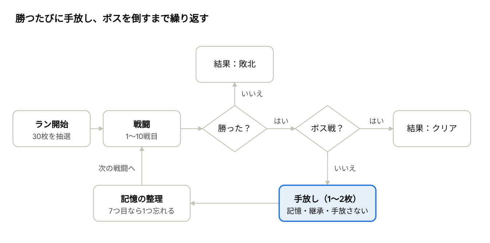

# 引き算デッキ（仮）MVP仕様書

Oct 18, 2026 · @小林和樹

## 概要

MVPで確かめたいことは1つだけ。「どのカードを手放すか悩むのが楽しいか」。

「引き算デッキ」は、重いデッキから始めて、戦闘に勝つたびにカードを手放していくデッキ構築ローグライク。手放したカードは消えずに「記憶」というパッシブ効果に変わる。カードは戦闘で使うほど「思い出」が貯まり、思い出が多いほど強い記憶になる。そのため「早く手放してデッキを軽くする」か「使い込んでから送り出す」かの判断が、ゲームの中心になる。

MVPは主人公1人・1章（通常戦闘9回＋ボス1回）だけで作る。絵はすべて仮素材（色付きの四角と文字）でよい。マップの分岐、ショップ、イベント、セーブは作らない。

- エンジン：Godot 4系（プロジェクト作成時点の最新安定版）、GDScript

- 想定プレイ時間：1ラン20〜30分

- 開発スタイル：オーナー（小林）はプログラムを書かない。Claude Codeが実装し、オーナーがテストプレイして口頭で修正を依頼する

## Claude Codeへの開発ルール

この章はリポジトリ直下の CLAUDE.md にそのまま貼る想定。仕様書本体は docs/SPEC.md に置く。

1.  作業は一度に1マイルストーンだけ。終わったら必ず止まって、オーナーにテストプレイを依頼する。

2.  作業報告は日本語の平易な言葉で書く。「何が変わったか」「どう遊べば確認できるか」「気になった点」の3つを必ず含める。コードの解説は不要。

3.  オーナーはコードを編集しない。数値の調整は、コードではなくデータファイル（.tres）か balance.tres の中だけで完結するように作る。

4.  カード・記憶・敵は必ずデータ（Resource）で定義する。新しいカードを足すのにスクリプトを書き換える必要がない設計にする。

5.  GDScriptは型付きで書く。1ファイルが長くなりすぎたら分割する。

6.  乱数はすべてラン開始時のシード値から生成する。シードは画面の隅に表示し、同じシードで同じ展開を再現できるようにする（不具合報告のため）。

7.  エラーが出たら、オーナーがエラー文を貼り付けるだけで原因を探せるように、主要な処理には分かりやすいログ（print）を残す。

8.  可能であれば、戦闘計算（ダメージ、ブロック、状態異常、記憶の発動）にはヘッドレスで実行できるテストを書き、変更のたびに実行して結果を報告する。

9.  仕様に書かれていないことを決める必要が出たら、勝手に大きく作り込まず、仮の実装にして報告の「気になった点」に書く。

## ランの流れと手放しのペース

1ランは通常戦闘9回とボス1回。30枚で始めて、全部手放せばボス戦には16枚で挑む計算になる。



1ランの流れ · 通常戦闘9回＋ボス1回

手放しは勝利後の報酬。序盤は重いデッキのだるさを早く抜けられるよう2枚ずつ、後半は1枚ずつにする。

| 戦闘           | 勝利後に手放せる枚数 | 想定デッキ枚数（戦闘開始時） |
|----------------|----------------------|------------------------------|
| 1〜5戦目       | 2枚                  | 30 → 22                      |
| 6〜9戦目       | 1枚                  | 20 → 17                      |
| 10戦目（ボス） | なし（ラン終了）     | 16                           |

**初期デッキの抽選**：カードプールからレア度の重み（基本50％、通常40％、希少10％）で30枚を選ぶ。同じカードの重複はあり。ただし打撃と防御は最低4枚ずつ入れる。

**枚数の根拠**：本番は40枚・3章を想定しているが、MVPは1章だけなので30枚に縮めている。30枚・手放し枚数・戦闘数はすべて balance.tres で変えられるようにし、テストプレイで調整する。

## 戦闘ルール

戦闘はSlay the Spire型のターン制。プレイヤーのターンにカードを使い、ターン終了で敵が予告どおりに行動する。以下の数値はすべて balance.tres で変更できるようにする。

| 項目       | 初期値                      | 補足                                   |
|------------|-----------------------------|----------------------------------------|
| 最大HP     | 60                          | 戦闘間で持ち越し。戦闘後の自動回復なし |
| エネルギー | 毎ターン3                   | 余りは持ち越さない                     |
| ドロー枚数 | 毎ターン5枚                 | 疲労で減る（下記）                     |
| 手札上限   | 10枚                        | 超えた分は引かずに捨て札へ             |
| ブロック   | 自分のターン開始時に0に戻る |                                        |

- ターン終了時、手札は捨て札へ（「保持」を持つカードを除く）。

- 敵は次の行動（攻撃○ダメージ、防御、状態異常など）を頭上にアイコンと数値で予告する。

- 勝利：敵が全滅。敗北：プレイヤーのHPが0になったらランの結果画面へ。

- カード種別はMVPでは「攻撃」「スキル」の2種類のみ。

**疲労**：デッキを削りすぎた無限ループを防ぐ仕組み。山札が尽きて捨て札をシャッフルし直すたびに、その戦闘のリシャッフル回数を数える。3回目以降のリシャッフル1回ごとに疲労が1増え、ターン開始時のドロー枚数が疲労1につき1枚減る（最低2枚）。疲労は戦闘終了でリセットする。画面には「疲労」の数値と、次のリシャッフルで疲労が増えるかを表示する。

**状態異常（MVPでは4種類）**

- 毒：ターン終了時にスタック数ぶんのダメージ。その後スタックが1減る。

- 筋力：攻撃カードのダメージがスタック数ぶん増える。戦闘中は持続。

- 脆弱：受けるダメージが1.5倍（端数切り捨て）。ターン終了時にスタックが1減る。

- 弱体：与えるダメージが0.75倍（端数切り捨て）。ターン終了時にスタックが1減る。

## 思い出・記憶・継承

手放したカードは「記憶」か「継承」のどちらかに変わる。どちらの強さも、そのカードに貯まった「思い出」で決まる。

**思い出**

- デッキ内の各カード（同名カードでも1枚ずつ別管理）が「思い出」の数値を持つ。初期値0、上限10。

- 戦闘中にそのカードを使うたびに思い出が1増える。

- カードの右上に思い出の数を小さく表示する。

**記憶**

- 手放したカードの「記憶効果」が、ラン終了まで続くパッシブ効果になる。

- 記憶効果は思い出の量で3段階に分かれる：淡い（0〜2）、確かな（3〜6）、鮮明な（7以上）。段階ごとに効果量を変える。

- 記憶の枠は6つ。7つ目が入るときは、新しいものを含む7つから1つを選んで完全に忘れる（ラン中は戻らない）。

- 発動タイミングは5種類：戦闘開始時、ターン開始時、特定の種類のカードを使ったとき、リシャッフル時、戦闘勝利時。

- 記憶が発動したときは、記憶一覧のアイコンを一瞬光らせて、何が起きたか分かるようにする。

**継承（マイルストーン4で実装）**

- 手放すカードが「継承キーワード」を持っていれば、記憶にする代わりに、デッキに残る別のカード1枚へキーワードを渡せる。

- 受け取ったカードには、手放したカードの思い出の半分（切り捨て）も加算される（上限10は守る）。

- 1枚のカードが受け取れるキーワードは3つまで。カード名の横に継承の数を小さく表示する。

- MVPのキーワードは6種類：保持（ターン終了時に捨てない）、軽量（コスト−1、最低0、重複しない）、連撃（攻撃回数＋1）、毒刃（使用時に毒2を付与）、一手（使用時に1枚引く）、堅牢（使用時にブロック3を得る）。

**手放さない選択**

手放し画面では「今回は手放さない」も選べる。その場合はHPを10回復する。デッキが薄くなりすぎるのを避けたいときの逃げ道になる。

## データ設計とフォルダ構成

「カードの定義（データ）」と「ラン中のカード1枚（実体）」を分けるのが設計の要。定義はResource（.tres）、実体はラン中にだけ存在するオブジェクトにする。

**定義データ（Resource）**

| クラス             | 主な項目                                                                                                                                                                                                           |
|--------------------|--------------------------------------------------------------------------------------------------------------------------------------------------------------------------------------------------------------------|
| CardData           | id、表示名、コスト、種別（攻撃/スキル）、レア度（基本/通常/希少）、効果の配列、キーワードの配列、継承キーワード（空でも可）、記憶（MemoryData）、フレーバーテキスト                                                |
| EffectData（基底） | apply（効果を実行）と describe（説明文を自動生成）を持つ。サブクラス：DamageEffect（量・回数・対象）、BlockEffect（量）、DrawEffect（枚数）、ApplyStatusEffect（状態異常・スタック・対象）、GainEnergyEffect（量） |
| MemoryData         | id、表示名、発動タイミング、発動条件（例：攻撃カード使用時）、3段階の効果量、効果（EffectData）、説明文テンプレート（例：「ターン開始時にブロック{v}を得る」）                                                     |
| EnemyData          | id、表示名、最大HP、行動パターン（順番どおり／重み付きランダム）、各行動の予告アイコンと効果                                                                                                                       |
| CardPool           | 初期デッキの抽選元になるカードとレア度ごとの重み                                                                                                                                                                   |
| BalanceConfig      | 「戦闘ルール」「ランの流れ」に出てくる数値すべて（balance.tres）                                                                                                                                                   |

**ラン中の実体**

- CardInstance：固有番号、元のCardData、思い出、継承で受け取ったキーワード。

- MemoryInstance：元のMemoryData、段階（淡い/確かな/鮮明な）。

- RunState（オートロード）：シード、乱数生成器、HP、デッキ（CardInstanceの配列）、記憶、何戦目か、統計（使ったカード数、手放した枚数など）。

**カードの説明文**：効果の配列から自動生成する。手書きの説明文と実際の効果がずれるのを防ぐため。

**フォルダ構成**

```
res://
  data/
    cards/      カード定義（.tres）1枚1ファイル
    memories/   記憶定義
    enemies/    敵定義
    pools/      カードプール
    balance.tres  数値設定
  scripts/
    resources/  CardData, EffectData など定義クラス
    effects/    EffectData のサブクラス
    runtime/    CardInstance, MemoryInstance
    autoload/   RunState
    battle/     戦闘の進行・計算
  scenes/
    title/ battle/ release/ memories/ result/
  tests/        ヘッドレステスト
```

## サンプルカード・記憶・敵

最初の実装確認用のサンプル。本番のカードプール（40〜50枚）は別途まとめて設計し、ここにあるカードは後で調整・差し替えてよい。記憶の数値は「淡い／確かな／鮮明な」の順。

**カード（12枚）**

| 名前       | レア度 | 種別   | コスト | 効果                                    | 継承キーワード | 記憶                                                                  |
|------------|--------|--------|--------|-----------------------------------------|----------------|-----------------------------------------------------------------------|
| 打撃       | 基本   | 攻撃   | 1      | 6ダメージ                               | なし           | 最初の一撃：戦闘開始時、ランダムな敵に2／4／7ダメージ                 |
| 防御       | 基本   | スキル | 1      | ブロック5                               | 堅牢           | 構え：ターン開始時にブロック1／2／4                                   |
| 古びた外套 | 基本   | スキル | 1      | ブロック4、保持                         | 保持           | 温もり：戦闘勝利時にHPを2／4／6回復                                   |
| 二連突き   | 通常   | 攻撃   | 1      | 3ダメージ×2回                           | 連撃           | 手数：1ターンに3枚目の攻撃カードを使ったとき、敵全体に1／2／3ダメージ |
| 足払い     | 通常   | 攻撃   | 1      | 5ダメージ、弱体1                        | なし           | 間合い：戦闘開始時、敵全体に弱体1／2／3                               |
| 重い一撃   | 通常   | 攻撃   | 2      | 14ダメージ                              | なし           | 重み：戦闘開始時に筋力1／2／3                                         |
| 毒の小瓶   | 通常   | スキル | 1      | 敵単体に毒4                             | 毒刃           | 残り香：戦闘開始時、敵全体に毒1／2／4                                 |
| 深呼吸     | 通常   | スキル | 0      | 2枚引く                                 | 一手           | 落ち着き：戦闘開始時に追加で1／2／3枚引く                             |
| 身軽な一歩 | 通常   | スキル | 0      | ブロック3                               | 軽量           | 軽やかさ：リシャッフル時にブロック3／5／8                             |
| 刃研ぎ     | 通常   | スキル | 1      | 筋力2                                   | なし           | 研ぎ澄まし：攻撃カード使用時、その攻撃に＋0／1／2ダメージ             |
| 星読み     | 希少   | スキル | 1      | 3枚引き、エネルギー1を得る              | 一手           | 導き：戦闘開始時にエネルギー1を得て、1／2／3枚引く                    |
| 決別の一閃 | 希少   | 攻撃   | 2      | 8ダメージ＋このカードの思い出×2ダメージ | 連撃           | 決別：戦闘開始時、これまでに手放した枚数×1／2／3のダメージを敵全体に  |

**敵**

| 名前               | HP   | 行動                                                                                                                     | 狙い                       |
|--------------------|------|--------------------------------------------------------------------------------------------------------------------------|----------------------------|
| 紙魚               | 22   | 6ダメージ → 山札の上から1枚を捨て札へ、を繰り返す                                                                        | 薄いデッキの疲労を早める   |
| 群れの蝙蝠（3体）  | 各10 | それぞれ4ダメージ                                                                                                        | 全体攻撃の価値を出す       |
| 毒沼の蛙           | 34   | 毒3を付与 → 8ダメージ、を繰り返す                                                                                        | 長期戦の圧                 |
| 錆びた番兵         | 40   | ブロック10 → 12ダメージ、を繰り返す                                                                                      | 瞬間火力の確認             |
| 急かす影           | 30   | 5ダメージを2回 → 3ターン目に25ダメージ（カウントダウン表示）                                                             | 重いデッキの遅さを罰する   |
| 忘却の司書（ボス） | 120  | 8ダメージ＋ランダムな記憶1つを2ターン封印 → 18ダメージ → ブロック15＋筋力2 → 手札をすべて捨てさせて6ダメージ、を繰り返す | 記憶と手札の両方を揺さぶる |

戦闘の割り当て：1〜3戦目は紙魚・蝙蝠・蛙から、4〜9戦目は番兵・影と、2体組み合わせ（紙魚×2、蛙＋紙魚など）から、10戦目は忘却の司書。

## 画面構成とデバッグ機能

画面は5つ。いちばん丁寧に作るのは「手放し画面」で、ここが悩ましく見えるかどうかがMVPの成否を決める。

| 画面     | 表示するもの・できること                                                                                                                                                                                                                     |
|----------|----------------------------------------------------------------------------------------------------------------------------------------------------------------------------------------------------------------------------------------------|
| タイトル | 「はじめる」、シード入力欄（空欄ならランダム）                                                                                                                                                                                               |
| 戦闘     | 手札（扇形、ホバーで拡大）、敵とHP・行動予告、自分のHP・ブロック・エネルギー・状態異常、疲労とリシャッフル回数、山札と捨て札の枚数（クリックで中身一覧）、記憶の6枠                                                                          |
| 手放し   | デッキ全体の一覧（思い出の多い順／種別順で並び替え）、残り手放し枚数、選んだカードの「記憶にした場合の効果（現在の段階と次の段階まであと何回）」と「継承できるキーワード」のプレビュー、決定前の確認、「今回は手放さない（HP10回復）」ボタン |
| 記憶一覧 | いつでも開ける。各記憶の効果・段階・元になったカードのフレーバーテキスト                                                                                                                                                                     |
| 結果     | 勝敗、到達した戦闘、最終デッキ枚数、記憶一覧、最も思い出が多かったカード、シード                                                                                                                                                             |

- カードを手放した瞬間に、そのカードのフレーバーテキストを1行だけ表示する。

- 手札の移動やカードを使う動きはTweenで簡単に付ける。凝った演出はMVPでは不要。

**デバッグ機能**（デバッグ実行時のみ有効）

- F1：現在の戦闘に即勝利

- F2：手放し画面へ直接移動

- F3：好きなカードを手札に追加

- F4：選んだカードの思い出を＋5

- F5：HPを全快

- F6：今のシードでランを最初からやり直す

## マイルストーンと確認方法

5段階で進める。いちばん大事な判定はマイルストーン3の終わりで、ここで「手放すのが悩ましくて楽しいか」を確かめる。楽しくなければ、継承や見た目に進む前にルールを見直す。

1.  **戦闘の最小形**：固定デッキ10枚（打撃5・防御5）で紙魚1体と戦える。エネルギー、ドロー、ブロック、敵の行動予告、勝敗まで。

    - 確認：1戦を最後まで遊べて、勝っても負けても止まらずに終わる。

2.  **データ化と全サンプル**：カード12枚・敵6種・状態異常4種をすべてResourceで定義。説明文の自動生成。戦闘計算のヘッドレステスト。

    - 確認：F3で各カードを手札に入れて使い、説明文どおりに動く。テスト結果が報告に載っている。

3.  **ランの流れ**：初期デッキ30枚の抽選、10戦（ボス含む）、手放し画面、思い出、記憶（6枠とあふれ処理）、手放さない選択、疲労、結果画面、シードの表示と再現。

    - 確認：1ランを最後まで遊べる。オーナーが3ラン以上遊び、「手放すカードで毎回迷ったか」「記憶の強さを実感できたか」「序盤がだるくないか」「終盤に薄いデッキ一択になっていないか」を判定する。

4.  **継承**：記憶か継承かの選択、継承先の選択、キーワードと思い出の受け渡し、継承数の表示。

    - 確認：継承を軸にしたランと記憶を軸にしたランで、プレイ感が変わる。

5.  **見た目と手触り**：手札とカード使用のTween、記憶発動時の光、手放し時のフレーバー表示、数値調整。

    - 確認：仮素材のままでも、遊んでいて操作に引っかかりがない。

## MVPでやらないこと

核の検証に関係しないものは作らない。必要になったら、MVPの判定が終わってから追加する。

- マップの分岐、ショップ、イベント、休憩所

- 2人目以降の主人公、ストーリー、ヒロインの会話シーン

- ラン途中のセーブとロード

- 周回要素（カードや記憶のアンロック、難易度段階）

- 本番用のイラスト、BGM、効果音

- 多言語対応、Steam連携

- 自動プレイによるバランス検証シミュレーション（MVPの判定後に検討）
